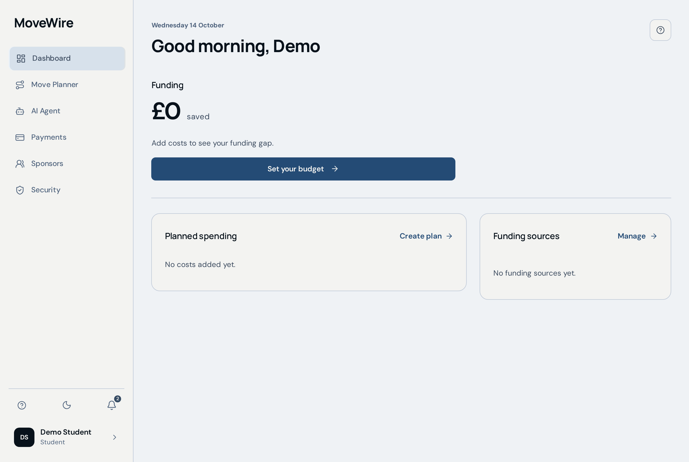
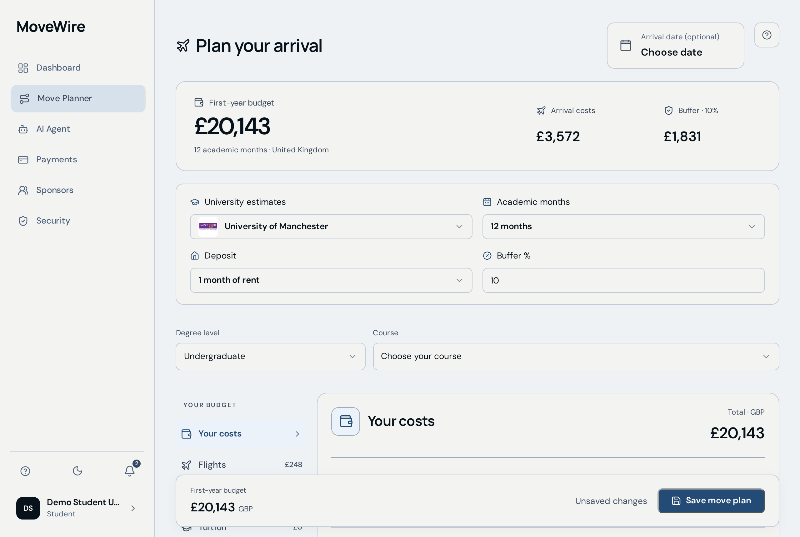
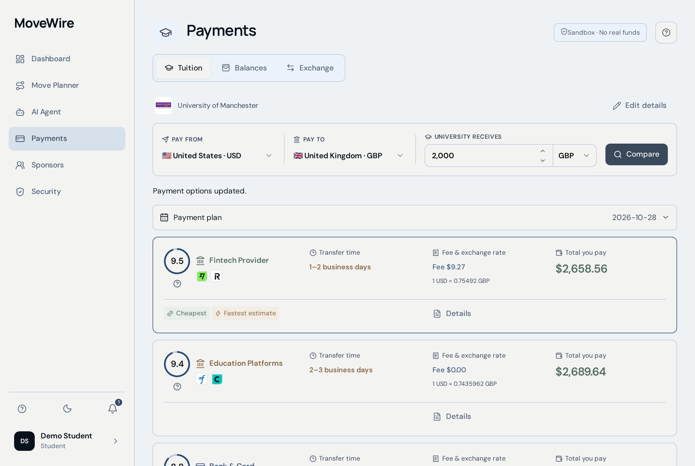
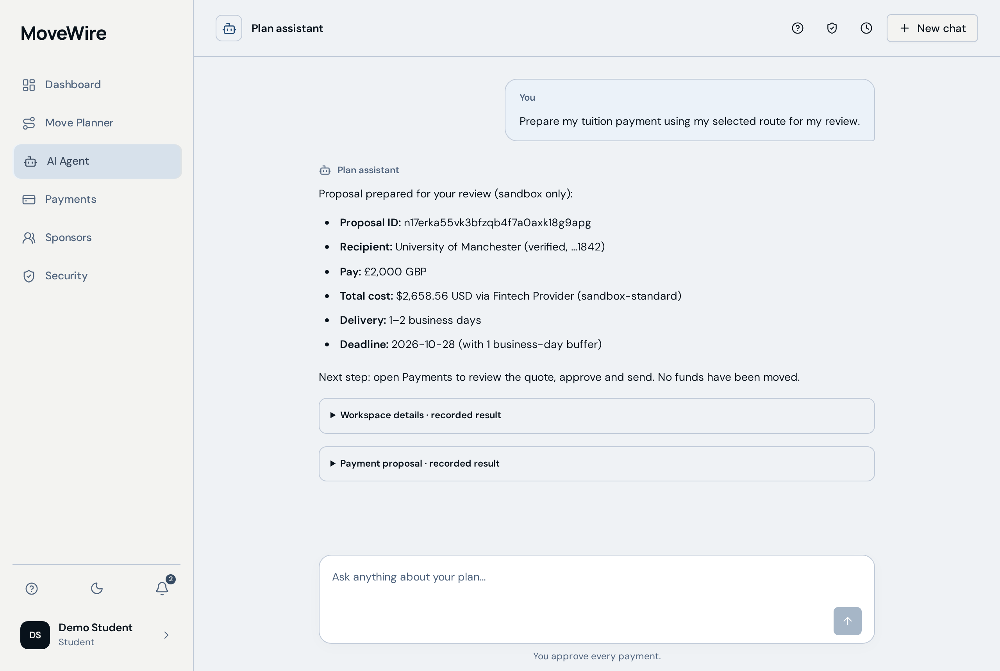

# MoveWire

MoveWire helps international students plan study costs, compare tuition payment routes, and coordinate with sponsors. Its AI assistant can explain costs, test currency changes, update plans, and prepare a payment for review.

**This is a sandbox. All balances and payments are simulated. No real money moves. Only the student can approve and send a payment.**

Competition: **Topic C — Cross-border & Student Finance Assistant**. [GitHub repository](https://github.com/qwlp/fintech).

## Screenshots

Demo screens with fictional data. No real money moves.

| Dashboard                                                                                      | Move Planner                                                                                              |
| ---------------------------------------------------------------------------------------------- | --------------------------------------------------------------------------------------------------------- |
|  |    |
| **Payments**                                                                                   | **AI Agent**                                                                                              |
|                    |  |

## Start here

- **Judges:** [submission checklist](docs/submission-checklist.md), [slides](docs/presentation.pdf), and [recorded demo](docs/evidence/sandbox-demo.webm).
- **Users:** [visual user guide](docs/demonstration-guide.pdf) ([editable source](docs/source/demonstration-guide.typ)).
- **Developers:** [setup and deployment](docs/local-deployment.md), [architecture](docs/architecture.md), and [test results](docs/validation.md).
- **Security:** [permissions, protections, and known risks](docs/security-self-assessment.md).

## Run on your computer

Install Bun and Docker with Compose. Use a fresh checkout, then run:

```sh
bun install --frozen-lockfile
bun run deploy:local
```

The first run creates `.env.self-hosted` and explains what to fill in. Choose an AI model that supports tool calling, edit that file, and run the command again. The script starts the backend, configures login and AI, builds the app, and starts the website at **http://127.0.0.1:8080**.

See [deployment instructions](docs/local-deployment.md) for prerequisites, AI settings, restart commands, troubleshooting, and the managed Convex alternative. Deployment to a local machine is separate from publishing a public website.

## Try the main task

1. Create a **Student** account and finish setup.
2. Open **Payments**. Set a tuition deadline and living-cost reserve. Refresh expired quotes.
3. Open a route's **Details**, select it, and confirm the example university in payment review.
4. Open **AI Agent**, allow AI processing, and ask: “Compare my tuition payment routes and check affordability.”
5. Ask: “Stress test my wallet if my home currency falls 10% against GBP.”
6. Ask: “Prepare my tuition payment.” Review the proposal in **Payments**, approve it, and send the simulated payment.
7. Download the receipt and records from **Profile → Security & activity → Payment history**.

A separate **Sponsor** account can connect using the student's single-use invitation. Students choose which financial summaries to share. Invitations expire after 24 hours.

Quotes expire after ten minutes. Changing payment terms requires resetting the proposal and approving again. Sending the same completed proposal again returns its existing receipt without another debit. Sponsor promises do not increase wallet cash.

## Check the project

```sh
bun run verify
# Optional browser checks (install Chromium first):
bunx playwright install chromium
bun run test:e2e
```

`verify` runs unit/backend tests, both TypeScript checks, the production build, and submission-file checks. It does not deploy or call a live model. [Validation notes](docs/validation.md) explain the recorded evidence and optional live checks.

## Project layout

| Folder                | Contents                                               |
| --------------------- | ------------------------------------------------------ |
| `src/`                | React interface                                        |
| `convex/`             | Backend, login, AI tools, payment checks, and database |
| `shared/`             | Shared types, tools, and planning data                 |
| `tests/`, `e2e/`      | Backend/unit tests and browser tests                   |
| `scripts/`, `deploy/` | Setup scripts and Docker configuration                 |
| `docs/`               | Submission materials, user guide, and evidence         |

## Limits

Supported destinations are China, the United Kingdom, and the United States, with a selected university list. Rates are reference values and provider fees are examples. Recipient confirmation is not bank verification. Delivery estimates use UTC weekdays and exclude bank holidays and university processing. AI explanations can be wrong; server calculations and payment checks enforce the controls.

Real banking, KYC/AML checks, email recovery, MFA, independent security review, and a student usability study are not complete. See the [security assessment](docs/security-self-assessment.md) for details.
