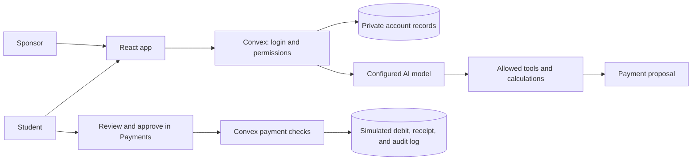

# How MoveWire works

MoveWire helps international students plan study costs, compare tuition routes, coordinate with sponsors, and complete a simulated payment. The interface uses React and TypeScript. Convex stores data, handles login, runs AI tools, and checks payments.

## Main flow



The server links every request to the logged-in account. The AI cannot choose another account ID. Sponsors receive only the summaries the student permits. The model can prepare a proposal; only the student can approve and send it.

## AI tools

| Tool                      | Result                                                                                         |
| ------------------------- | ---------------------------------------------------------------------------------------------- |
| `compare_payment_routes`  | Compare fresh quotes against cost, deadline, wallet funds, and living reserve                  |
| `simulate_budget`         | Estimate monthly costs and how long available funds would last                                 |
| `stress_test_fx`          | Show a hypothetical currency loss                                                              |
| `prepare_tuition_payment` | Save a fixed payment proposal for student review                                               |
| Planning tools            | Update requested profile, tuition, planner, budget, checklist, alert, and account-label fields |

Tool definitions are in `shared/agent-tools.ts`; server checks and dispatch are in `convex/agentTools.ts`. Tools read current values before applying partial edits. Grouped study-plan edits succeed or fail together. Declared funding changes do not credit a wallet. Changes to confirmed funding require a student confirmation card; it expires after 30 minutes and is rejected if the underlying records changed.

AI requires consent. Each account is limited to one request per ten seconds and 100 per UTC day. A model response can request up to three tools; a conversation request allows three tool rounds and a final explanation. Each provider request has a 45-second timeout. If a tool succeeds but the explanation fails, its results and any proposal remain available. Consent is checked again before saving the exchange.

Preparing a payment requires a direct request. A conservative English-language check rejects tested quoted, negative, and hypothetical requests. This is an extra guard, not a complete prompt-injection detector.

## Payment calculation

Amounts in proposals and ledger records use integer minor units: 100 cents = one dollar. For currencies supported by the sandbox:

```text
recipientMinor = round(recipientAmount × 100)
sourceMinor = ceil(recipientMinor / targetCurrencyPerSourceCurrency)
feeMinor = round(sourceCurrencyFee × 100)
totalDebitMinor = sourceMinor + feeMinor
```

Rounding the source amount up avoids underpaying the recipient. Inputs must be finite, valid, and within safe integer limits. Some older code names use GBP and USD; sandbox execution supports USD, GBP, and CNY.

The source wallet must cover the debit. The study-currency value of all wallets after payment must also cover the saved living reserve (default £1,000). Remaining funds already include that reserve; it must not be counted twice. Sponsor promises are excluded from available wallet cash.

Provider fees are examples. Fetched daily reference rates are comparison inputs, not binding provider quotes. Wallet valuations are scenario data.

## Route and deadline checks

`convex/tuitionDecision.ts` shares the decision rules between the interface and backend. The recommended route is the cheapest one that has a fresh quote, enough funds, a preserved reserve, and estimated arrival within the saved deadline.

Estimated arrival uses the route's maximum delivery days plus a student-selected buffer of 0–5 business days. Dates use UTC; business days are Monday–Friday. Bank holidays, cutoffs, and university processing are excluded. Missing dates or delivery windows block a route.

For a funding gap, the tool estimates the extra USD needed to cover both the source-cash shortfall and the living reserve. It takes the larger requirement and rounds up. This estimate does not send a sponsor request or add cash.

## Payment steps

1. **Review:** choose a route and confirm the example university. This is an acknowledgment, not bank verification.
2. **Prepare:** save fixed terms: recipient, provider, rate, fee, amounts, reserve, deadline, buffer, and delivery window. The proposal cannot outlive its quote.
3. **Approve:** the student approves that exact, unexpired proposal ID.
4. **Send:** the server checks ownership, approval, funds, reserve, expiry, and buffered arrival again.
5. **Record:** one database transaction debits the wallet, adds the ledger entry, saves a UUID receipt, and marks completion. Failure saves none of these changes.

Sending a completed proposal again returns its existing receipt. Resetting cancels outstanding proposals but does not undo completed payments or refill wallets. Payment-term edits and quote refresh require resetting an active proposal and obtaining fresh approval.

## Other calculations and evidence

Rent simulation treats matching plan costs as annual totals and divides by 12. Monthly burn is rent plus other monthly costs; runway is liquid GBP value divided by burn. Zero burn has no finite runway. Currency stress tests reduce non-GBP wallet valuations by the requested percentage; they are scenarios, not forecasts.

Successful tools save account-private calculation records. The latest 50 appear in account data and evidence exports. Chat also keeps each exchange's tool results, including errors, beside the generated explanation. Sponsors cannot read these records.

[Validation](validation.md) distinguishes local tests from the recorded live-model journey. No external bank settlement is claimed. See the [security assessment](security-self-assessment.md) for permissions and remaining risks.
