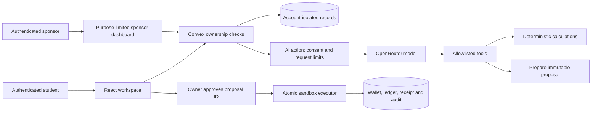

# MoveWire technical documentation

## Purpose

Topic C: help an international student compare tuition-payment routes, assess affordability while retaining living funds, coordinate sponsors privately and complete an approved payment in a verifiable sandbox.

## System architecture



The model has no approval or execution tool. All tool calls are bound to the authenticated account by the server; the model cannot supply another account ID. Sponsor queries project only permitted data instead of returning a student's account object.

## Agent tools

| Tool                      | Capability                                                                                                         | Writes                         |
| ------------------------- | ------------------------------------------------------------------------------------------------------------------ | ------------------------------ |
| `compare_payment_routes`  | Rank fresh routes by cost subject to deadline, buffer, available cash and reserve; explain blockers and USD top-up | Audit event                    |
| `simulate_budget`         | Replace hypothetical monthly rent and calculate burn and runway                                                    | Audit event                    |
| `stress_test_fx`          | Revalue non-GBP wallets under a specified adverse percentage                                                       | Audit event                    |
| `prepare_tuition_payment` | Prepare the selected tuition route for owner review                                                                | Proposal, account state, audit |

The last tool requires a direct prepare/draft payment request in the current turn and rejects quoted, negated and common hypothetical/instruction-discussion phrasing. This conservative English-language heuristic is an additional preparation guard, not a general prompt-injection detector. Preparation cannot move funds. Tools validate arguments and recheck ownership and AI consent. Each model response can request at most three calls, with three tool rounds and a final text round. Each model request has a 45-second timeout. Requests are spaced by at least ten seconds per account and capped at 100 per UTC day. When a tool has already returned but the later model explanation fails, the action saves the tool evidence with an explicit fallback message. Consent is checked again before saving the exchange.

## Financial algorithms

Payment amounts are stored as integer minor units in proposals and ledger entries. For the sandbox USD-to-GBP quote:

```
recipientMinor = round(recipientGBP * 100)
sourceMinor = ceil(recipientMinor / rateGBPPerUSD)
feeMinor = round(feeUSD * 100)
totalMinor = sourceMinor + feeMinor
```

Rounding the source amount up avoids underfunding the target. Values must be finite, positive where appropriate and within safe integer precision. The sandbox intentionally supports this single execution corridor; other country comparisons are planning estimates only.

Available source funds must cover total cost. The projected GBP valuation of all wallets after the debit must preserve the configured living-cost reserve (default £1,000). The executor repeats these checks at execution because balances can change after preparation. Wallet valuations are scenario data, not live FX prices.

For rent simulation, matching recurring cost items are treated as annual plan totals and divided by 12. The tool returns this assumption explicitly. Burn equals hypothetical rent plus other monthly costs; runway equals liquid GBP valuation divided by burn. Zero burn returns no finite runway. The FX stress test reduces only non-GBP wallet valuations by the requested percentage; it is not a forecast.

## Deadline and funding decisions

`convex/tuitionDecision.ts` is shared by the UI, server comparison tool and payment enforcement. It recommends the cheapest route with a valid fresh quote, sufficient available USD, preserved living funds, and buffered estimated arrival no later than the saved tuition deadline. Missing dates or delivery windows block eligibility rather than being inferred. Quote freshness is independent of affordability.

Arrival uses the maximum declared delivery business days plus an owner-selected buffer of 0–5 days. Dates are interpreted in UTC and business days are Monday–Friday. This deliberately excludes bank holidays, cutoffs and university processing; the UI and tool disclose that arrival is an estimate, not a settlement guarantee.

For blocked funding, the illustrative additional USD estimate is the larger of the source-cash gap and the USD required to close the GBP reserve shortfall, rounded up to source cents using the existing USD wallet valuation. It is not a request sent to a sponsor, and promised funding is excluded. Actual funds and a fresh quote must be checked again.

The total `remainingGBP` already includes the protected reserve. The reserve must not be added a second time. The saved deadline, buffer and reserve cannot be changed while a proposal is active. Owners may reset before changing the plan or refreshing known sandbox fixtures; the AI has no tool to lower the reserve or alter planning terms.

## Payment protocol

1. Owner loads sandbox scenario and confirms sample recipient suffix.
2. Prepare snapshots recipient, provider, rate, fee, target amount, source total, reserve, deadline, buffer and delivery window. Proposal expiry never exceeds the source quote expiry.
3. Approve requires the latest proposal ID, an authenticated student owner, prepared state and an unexpired quote.
4. Execute requires that same proposal ID and its recorded owner approval.
5. Execution rechecks balances, reserve and buffered arrival against the immutable snapshot, including UTC date rollover. A single Convex mutation updates the source wallet, appends a ledger entry, records a UUID receipt and marks completion. Mutation failure commits none of those changes.
6. Re-executing that completed proposal returns the existing receipt even after newer proposals exist. Provider changes are blocked while a proposal is active. Reset cancels outstanding proposals; historical completed records remain.

Configuration changes do not alter the approved snapshot. The frontend displays snapshot terms while a proposal is active.

## Recorded calculation evidence

Successful tools append owner-isolated `toolExecutions`. The latest 50 are included in bootstrap and the owner evidence export. Sponsor queries do not expose this table. Each completed chat exchange also stores its own tool results, including tool errors, so the financial calculation can be inspected next to generated prose. Raw current live-evaluation responses and failed prior run summaries are retained separately from authenticated financial records.

## Evidence and limitations

`tests/payment-engine.test.ts` exercises the real Convex handlers in a local transactional test environment. Exported evidence contains the prepared/approved/completed proposal, ledger and actor-timestamp audit events. This proves application-level sandbox behavior; it does not demonstrate an external provider settlement. Live browser tests independently exercise the configured development backend.

Financial recommendations in model prose remain fallible. Backend controls protect fund transitions, not the truth of every sentence. No real banking, KYC/AML verification, sanctions screening, credit reporting or verified settlement is claimed.
